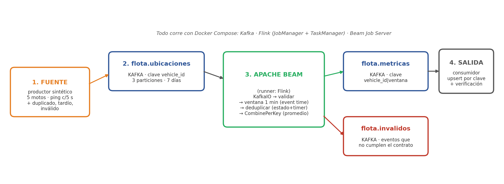

# TP — Velocidad de una flota de delivery en tiempo real

**Streaming de datos y sus aplicaciones** — Maestría en Inteligencia Artificial, FP-UNA.
**Integrante:** Nicolás David Blanco Yaluff (trabajo individual: diseño, código, pruebas y documentación).

Un pipeline **Kafka → Apache Beam (sobre Flink) → Kafka** que calcula la **velocidad promedio de cada moto por minuto** a partir de las ubicaciones que manda la app de los repartidores. Continúa el diseño de la Tarea 1 (tópicos y claves) y la Tarea 2 (política temporal).



## Qué hace cada parte

| Parte | Archivo | Qué hace |
|---|---|---|
| Fuente | `src/flota/productor.py` | 5 motos mandan su ubicación cada 5 s durante 3 min. Mete a propósito: 1 duplicado, 1 desordenado, 1 tardío, 1 demasiado tardío y 1 inválido. Guarda todo lo enviado en `data/enviados.jsonl`. |
| Kafka | `docker-compose.yml` | Tópicos `flota.ubicaciones` (entrada, clave `vehicle_id`, 3 particiones), `flota.metricas` (salida) y `flota.invalidos`. |
| Beam | `src/flota/pipeline.py`, `transforms.py` | Lee con **KafkaIO**, valida, usa el **tiempo de evento**, ventana fija de 1 min, **deduplica** por `event_id` (estado + timer) y calcula el promedio con **CombinePerKey**. Corre en **Flink** (PortableRunner). |
| Salida | `src/flota/consumidor.py` | Lee `flota.metricas`, hace **upsert por clave** `vehicle_id|ventana` y verifica cada caso especial contra lo enviado. |

## Cómo ejecutarlo

Requisitos: **Docker Desktop** (unos 6 GB de memoria para Docker) e Internet la primera vez.

```bash
# 1. Construir imágenes y levantar Kafka + Flink (la primera vez tarda ~15 min)
docker compose --profile demo build
docker compose up -d

# 2. Producir 3 minutos de eventos
docker compose run --rm app python -m flota.productor

# 3. Ejecutar el pipeline en Flink (lee lo que hay en Kafka, procesa y termina; ~4 min)
docker compose run --rm pipeline

# 4. Ver el resultado y la verificación
docker compose run --rm app python -m flota.consumidor

# Pruebas (dentro del contenedor)
docker compose run --rm --no-deps app pytest -v

# Detener todo
docker compose down
```

Interfaz de Flink: <http://localhost:8081>.

Al correr el paso 3 **otra vez**, el pipeline vuelve a leer todo desde el principio (*replay*): `flota.metricas` recibe el doble de mensajes, pero el consumidor sigue mostrando las **mismas filas**, porque hace upsert por clave.

## Resultado (evidencia en `docs/evidencia/`)

- **21/21 ventanas** (moto × minuto) coinciden con lo enviado.
- **Duplicado:** la ventana de VH-001 tiene 12 pings, no 13.
- **Desordenado y tardío:** quedan en la ventana de su `event_time`, no en la de llegada.
- **Inválido:** va a `flota.invalidos`.
- **Replay:** 2 corridas → 42 mensajes en `flota.metricas` → 21 filas tras el upsert.
- **Pruebas:** 6/6 en verde (`tests/test_flota.py`), incluidas dos con `TestStream`: un tardío dentro de los 2 min corrige el resultado (pane `LATE`) y uno demasiado tardío se descarta.

## Decisiones principales

- **Clave `vehicle_id`:** los pings de cada moto van a la misma partición, en orden. Las 5 motos se reparten en las 3 particiones.
- **Tiempo de evento:** el `event_time` del celular. El productor también lo pone como timestamp del mensaje de Kafka.
- **Ventana de 1 min y lateness de 2 min** para que la demo dure minutos. En producción serían 5 y 10 min (Tarea 2).
- **Deduplicación** por `event_id` con estado por moto y ventana, y un timer que lo borra al vencer la lateness (Tarea 3).
- **Idempotencia:** cada resultado sale con la clave `vehicle_id|ventana`. Repetir una escritura no crea filas nuevas en la tabla materializada.
- **Semántica:** *at-least-once* hasta Kafka. El resultado materializado es correcto gracias al dedup y al upsert. **No** se promete *exactly-once* de punta a punta.

## Límites conocidos

- **Lectura acotada.** La lectura continua de KafkaIO (SDF) quedaba trabada en este Flink local: el job corría pero no emitía nada. Se usa lectura acotada (`max_read_time`), igual que el smoke test del laboratorio de la Clase 7. Consecuencia: durante la lectura el watermark no avanza, así que en la demo el evento «demasiado tardío» se acepta. El descarte por lateness se demuestra con `TestStream`.
- `flota.invalidos` solo agrega mensajes: en un replay, el inválido aparece dos veces.
- Un solo broker y un TaskManager (paralelismo 1): es un entorno de laboratorio, no de producción.
- Datos sintéticos (semilla fija); la hora real cambia en cada corrida.
